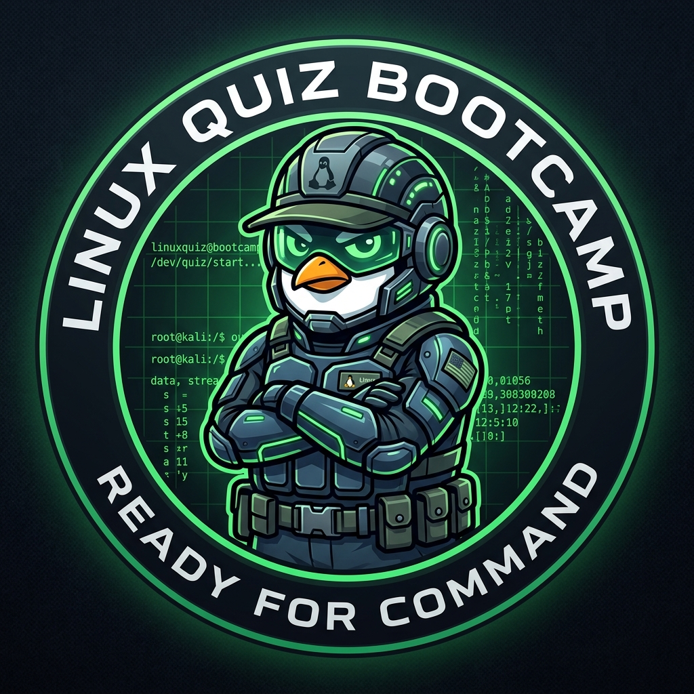

<div align="center">
  
  
  # 🐧 Linux Bootcamp PWA
  
  **Eine interaktive, KI-gestützte Lernplattform (Progressive Web App) für angehende Linux-Administratoren.** <br>
  *Lerne Kommandozeilen, Konfigurationen und Server-Basics spielerisch durch ein XP- und Ränge-System.*
</div>

---

## ✨ Features

- 🧠 **KI-Tutor Integration:** Verknüpfbar mit Google Gemini, OpenAI oder lokalen LLMs (Ollama), um falsch beantwortete Fragen detailliert und verständlich im "Ausbilder-Ton" zu erklären.
- 🎓 **Klausur-Modus:** Simuliert eine echte IHK-Prüfungssituation (45 Minuten Timer, 24 Fragen quer durch alle Kategorien, automatische Notenberechnung von 1 bis 6).
- 🏆 **Gamification & Ränge:** Sammle XP durch korrekte Antworten, halte deine Streak und steige im Dienstgrad auf (von *Schütze* bis *General* – basierend auf den Bundeswehr-Dienstgraden).
- 📱 **Progressive Web App (PWA):** Kann als native App auf Android, iOS oder dem Desktop installiert werden. Funktioniert auch bei schlechter Internetverbindung dank Service Worker Caching.
- 👨‍💻 **Admin-Konsole:** Integriertes Lehrer-Pult zur Verwaltung von Benutzern, Rechten und zur Einsicht aller absolvierten Schüler-Klausuren.
- 🐳 **Docker-Ready:** Vollständig isoliertes Setup für sekundenschnelles Deployment auf jedem Linux-Server.

---

## 🚀 Installation & Deployment

Das Projekt ist für den produktiven Einsatz vorkonfiguriert und nutzt Docker zur Isolierung.

### Voraussetzungen
- Docker
- Docker Compose

### ⚡ Quickstart (Der Einzeiler)

Mit einem einzigen Befehl alles klonen, vorbereiten, starten und direkt im Browser öffnen:

```bash
git clone https://github.com/deltaInfoSecTeam/linux_bootcamp.git && cd linux_bootcamp && touch bootcamp.db && (sudo docker compose up -d --build 2>/dev/null || sudo docker-compose up -d --build) && (xdg-open http://localhost:8000 2>/dev/null || echo -e "\n🎉 Bootcamp läuft bereit unter: http://localhost:8000\n")
```

---

### Schritt-für-Schritt Starten

1. Repository klonen:
   ```bash
   git clone https://github.com/deltaInfoSecTeam/linux_bootcamp.git
   cd linux_bootcamp
   ```

2. Initiale Datenbankdatei anlegen (verhindert Docker-Fehler beim Mounten):
   ```bash
   touch bootcamp.db
   ```

3. Docker Container bauen und starten:
   ```bash
   docker-compose up -d --build
   ```

Die App ist nun unter `http://<deine-server-ip>:8000` erreichbar. 

*(Hinweis: Für den produktiven Einsatz wird empfohlen, einen Reverse Proxy wie Nginx oder Traefik vorzuschalten, um SSL/HTTPS zu aktivieren. Dies ist für PWA-Funktionen auf mobilen Endgeräten zwingend erforderlich).*

---

## 🛠️ Technologie-Stack

- **Frontend:** Vanilla JavaScript, HTML5, CSS3 (Kein Framework-Overhead!)
- **Backend:** Node.js, Express
- **Datenbank:** SQLite (`bootcamp.db` – extrem portabel und leichtgewichtig)
- **Authentifizierung:** JWT (JSON Web Tokens) & Bcrypt
- **Architektur:** Client-Server, PWA (Manifest & Service Worker)

---

## 🤖 KI-Integration einrichten

Im Menü unter **"⚙️ Einstellungen"** kannst du deinen bevorzugten LLM-Anbieter auswählen:
1. **Google Gemini (Empfohlen):** Füge deinen Gemini API Key ein.
2. **OpenAI:** Nutze `gpt-4o-mini` oder ähnliche Modelle mit deinem OpenAI Key.
3. **Ollama:** Für den lokalen, komplett datenschutzkonformen Betrieb (z.B. Llama 3.1). Wähle `ollama` und gib die lokale URL deines Ollama-Servers an.

---

## 📜 Lizenz

Dieses Projekt ist Open-Source und für Bildungszwecke konzipiert.
