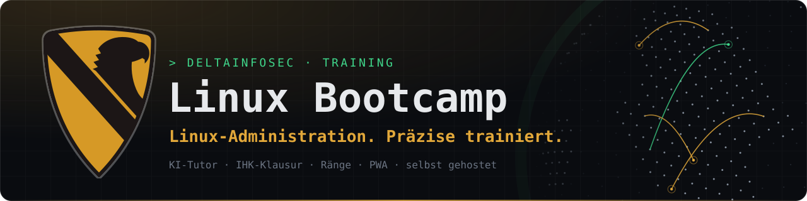
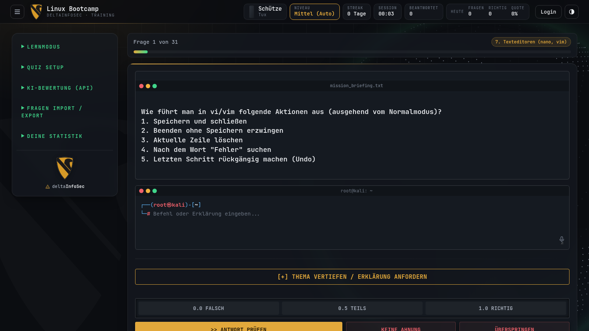

<div align="center">



<br>

**Interaktive, KI-gestützte Lernplattform (PWA) für angehende Linux-Administratoren.**<br>
<sub>Kommandozeile, Konfiguration und Server-Grundlagen. Mit XP, Rängen und Klausur-Modus.</sub>

<br>

[`Features`](#01-features) · [`Installation`](#02-installation--deployment) · [`Struktur`](#03-projektstruktur) · [`Corporate Design`](#04-corporate-design) · [`Sicherheit`](#05-sicherheit) · [`KI`](#07-ki-integration-einrichten)

</div>

<br>

<p align="center">
  
</p>

---

## `01` Features

| Modul | Beschreibung |
|---|---|
| **KI-Tutor** | Erklärt falsch beantwortete Fragen ausführlich im Ausbilder-Ton. Anbindung an Google Gemini, OpenAI, Groq, xAI, Together oder ein lokales Ollama. |
| **Klausur-Modus** | Simuliert eine IHK-Prüfung: 45 Minuten, 24 Fragen quer durch alle Kategorien, Note 1 bis 6. |
| **Ränge** | XP für richtige Antworten, Streaks und Dienstgrade von *Schütze* bis *General* (angelehnt an die Bundeswehr). |
| **PWA** | Installierbar auf Android, iOS und Desktop. Läuft dank Service Worker auch bei schlechter Verbindung. |
| **Admin-Konsole** | Benutzer und Rechte verwalten, alle abgelegten Klausuren einsehen, Inhalte pflegen. |
| **Docker** | Isoliertes Setup, das mit einem Skript auf jedem Linux-Server läuft. |

---

## `02` Installation & Deployment

### Voraussetzungen
- Ein Linux mit apt (Debian, Ubuntu, Raspberry Pi OS, Kali), `git` und `sudo`
- Docker wird vom Installationsskript bei Bedarf mitinstalliert

### Quickstart

Klone das Repo **als normaler Nutzer**, nicht mit `sudo`, und starte das Installationsskript:

```bash
git clone https://github.com/deltaInfoSecTeam/linux_bootcamp.git && cd linux_bootcamp && ./scripts/install.sh --admin <dein-username>
```

Das Skript
1. prüft, ob Docker und Docker Compose vorhanden sind, und installiert sie nach Rückfrage über apt,
2. korrigiert die Dateirechte (`data/` muss UID 1000 gehören, dem Nutzer im Container),
3. legt `.env` aus `.env.example` an,
4. baut und startet den Container und wartet auf den Healthcheck,
5. legt mit `--admin` den ersten Admin an. Passwort und Recovery-Token erscheinen **einmalig**. Ohne `--admin` zeigt es stattdessen einen Setup-Code für die Einrichtung im Browser (siehe unten).

Mehrfaches Ausführen schadet nicht, dasselbe Skript dient auch für Updates (`git pull && ./scripts/install.sh`). Weitere Optionen zeigt `./scripts/install.sh --help`.

Danach läuft die App unter `http://localhost:8000`. Standardmäßig ist sie **nur lokal** erreichbar (`127.0.0.1`).

### Manuelle Installation

Wer Docker selbst verwaltet (Compose v2 nötig):

```bash
cp .env.example .env && sudo chown -R 1000:1000 data && docker compose up -d --build
```

### Ersten Admin im Browser einrichten

Gibt es noch keinen Admin, erzeugt der Server bei jedem Start einen einmaligen **Setup-Code**. `install.sh` zeigt ihn am Ende an, außerdem steht er im Container-Log (`docker compose logs bootcamp`) und in `data/setup-code`. Beim ersten Aufruf der Seite öffnet sich automatisch der Dialog „Ersten Admin einrichten“: Setup-Code, Benutzername und Passwort eingeben, fertig.

- Ohne den Code kann niemand Admin werden, auch nicht, wer die Seite zufällig als Erster öffnet.
- Sobald ein Admin existiert, ist die Einrichtung dauerhaft geschlossen und der Code gelöscht.
- Der Endpunkt ist streng begrenzt (10 Versuche in 15 Minuten), der Code hat 60 Bit Zufall.

### Recovery-Token

Nach der Registrierung oder Einrichtung erscheint der Recovery-Token **einmalig** in einem Dialog. Dort lässt er sich als Textdatei herunterladen oder kopieren; weiter geht es erst nach der Bestätigung, dass er gespeichert ist. Auf dem Server liegt nur ein Hash, der Token selbst wird nirgends gespeichert. Mit ihm setzt man unter „Passwort vergessen?“ ein neues Passwort.

### Weitere Admins und Notfall-Reset

```bash
sudo docker compose exec bootcamp node scripts/create-admin.js <username>
```

Existiert der Nutzer schon, wird er zum Admin. Sonst wird er neu angelegt, und Passwort plus Recovery-Token werden **einmalig** ausgegeben.

Hat ein Nutzer Passwort und Recovery-Token verloren, setzt ein Admin mit Zugriff auf den Server beides neu. Alle Sitzungen des Nutzers werden dabei abgemeldet:

```bash
sudo docker compose exec bootcamp node scripts/create-admin.js <username> --reset
```

### Zugriff von außen (Server / LAN)

Öffne den Port nicht direkt, sondern setze einen Reverse Proxy mit HTTPS davor. Ein Beispiel mit Caddy, das das Zertifikat automatisch holt:

```
bootcamp.example.de {
    reverse_proxy 127.0.0.1:8000
}
```

Setze dazu in `.env` den Wert `TRUST_PROXY=1`. HTTPS ist für PWA-Funktionen auf Mobilgeräten ohnehin Pflicht.

### HTTPS im Heimnetz mit grünem Schloss (`--tls`)

Ohne öffentliche Domain gibt es kein Zertifikat von Let's Encrypt. Dafür bringt das Installationsskript eine eigene kleine Zertifizierungsstelle (CA) mit:

```bash
./scripts/install.sh --tls
```

Das Skript
1. erzeugt eine eigene CA und damit ein Zertifikat für `localhost`, den Hostnamen, `<hostname>.local` und die IP-Adressen des Rechners,
2. hinterlegt die CA als vertrauenswürdig im System (`curl`, `wget` …) sowie in Firefox und Chrome/Chromium des Nutzers, der das Skript startet (installiert dafür `libnss3-tools`),
3. trägt `TLS_CERT_PATH` und `TLS_KEY_PATH` in `.env` ein und startet den Container mit HTTPS.

Danach den Browser einmal neu starten. `https://localhost:8000` zeigt dann ein gültiges Zertifikat ohne Warnung.

**Sicherheit:** Die CA ist per *Name Constraints* auf lokale Namen (`localhost`, `.local`, `.lan`, `.home.arpa`, `.internal`, `.intern`, den Hostnamen) und private IP-Bereiche (`10/8`, `172.16/12`, `192.168/16`, `127/8`, `fc00::/7`) beschränkt. Selbst wenn ihr privater Schlüssel (`tls/ca/ca.key`, nur für root lesbar) in falsche Hände gerät, lassen sich damit keine Zertifikate für fremde Websites fälschen.

**Weitere Hostnamen**, z. B. eine interne Domain: in `.env` eintragen und das Skript erneut ausführen. Öffentliche Domains werden bewusst nur so aufgenommen. Jeder Eintrag erlaubt der CA auch alle Subdomains, deshalb nur eigene, vollständige Namen eintragen (z. B. `schule.lan`, nicht `lan` oder `com`); ungültige Einträge lehnt das Skript ab.

```
TLS_HOSTNAMES=bootcamp.intern.example.org,schule.lan
```

**Erneuerung:** Das Serverzertifikat gilt 825 Tage. Jeder weitere Lauf von `./scripts/install.sh` prüft es und stellt es neu aus, wenn es bald abläuft oder sich IP-Adresse oder Hostname geändert haben.

**Andere Geräte** (Handy, Laptop) vertrauen der CA erst, wenn sie dort importiert ist. Der Server bietet das öffentliche CA-Zertifikat dafür unter `https://<server>/ca.crt` an. Das ist nur das Zertifikat, der private Schlüssel verlässt den Server nie. `./scripts/install.sh` zeigt am Ende den Fingerabdruck und einen fertigen Befehl für Linux-Rechner an.

**Linux-Rechner per Skript:** `scripts/trust-ca.sh` läuft auf dem Client:

```bash
curl -fsSL https://raw.githubusercontent.com/<owner>/<repo>/main/scripts/trust-ca.sh | bash -s -- --server <name> --fingerprint <SHA-256>
```

- lädt `ca.crt` vom Server und **bricht ab, wenn der Fingerabdruck nicht exakt passt**,
- installiert nur eine echte CA **mit kritischen Name Constraints**,
- trägt sie ins System ein (Debian/Ubuntu/Kali, Fedora/RHEL, Arch) und in **jedes Firefox-Profil** sowie **Chromium/Chrome**, jeweils als vertrauenswürdig für Webseiten (installiert dafür bei Bedarf `certutil`),
- `--ip <adresse>` legt einen `/etc/hosts`-Eintrag an, falls der Name nicht auflösbar ist, `--port` für einen anderen Port als 443,
- `--replace-old` entfernt ältere Bootcamp-CAs (z. B. nach einem Neuaufsetzen des Servers), `--dry-run` zeigt nur an, `--uninstall` macht alles rückgängig.

**Andere Systeme manuell** (`https://<server>/ca.crt` laden, Fingerabdruck vergleichen):
- **Android:** Einstellungen → Sicherheit → Verschlüsselung & Anmeldedaten → Zertifikat installieren → CA-Zertifikat
- **iOS/iPadOS:** Datei öffnen, Profil installieren, dann unter Einstellungen → Allgemein → Info → Zertifikatsvertrauenseinstellungen aktivieren
- **Windows:** Datei doppelklicken → Zertifikat installieren → „Vertrauenswürdige Stammzertifizierungsstellen“
- **macOS:** Schlüsselbundverwaltung → System → Zertifikat öffnen → Vertrauen → „Immer vertrauen“
- **Firefox** (eigener Speicher): Einstellungen → Zertifikate anzeigen → Zertifizierungsstellen → Importieren → „Dieser CA vertrauen, um Websites zu identifizieren“ **anhaken**

**Ohne Portnummer (Port 443):** Ist Port 443 frei, in `.env` einfach `HOST_PORT=443` setzen und das Skript erneut ausführen. Läuft auf dem Rechner schon ein nginx auf 443, kann er Bootcamp anhand des Namens weiterreichen (SNI), mit demselben Zertifikat:

```
server {
    listen 443 ssl default_server;
    server_name _;
    ssl_certificate     /pfad/zu/linux_bootcamp/tls/server/server.crt;
    ssl_certificate_key /pfad/zu/linux_bootcamp/tls/server/server.key;
    location / {
        proxy_pass https://127.0.0.1:8000;
        proxy_ssl_verify on;
        proxy_ssl_trusted_certificate /pfad/zu/linux_bootcamp/tls/linux-bootcamp-ca.crt;
        proxy_ssl_name localhost;
        proxy_set_header Host $host;
        proxy_set_header X-Forwarded-For $proxy_add_x_forwarded_for;
        proxy_set_header X-Forwarded-Proto $scheme;
    }
}
```

Dazu `TRUST_PROXY=1` in `.env`. Wird das Zertifikat erneuert, lädt `tls.sh` nginx automatisch neu.

**Verwalten:**

```bash
./scripts/tls.sh status           # Zertifikate und Ablaufdaten anzeigen
sudo ./scripts/tls.sh untrust     # CA aus System und Browsern entfernen
```

### Daten & Secrets

- Alles Persistente liegt in `./data/`: `bootcamp.db`, `.jwt_secret`, `.encryption_secret`.
- Die Secrets werden beim ersten Start zufällig erzeugt. Alternativ trägst du sie in `.env` ein.
- **Backup:** den Ordner `./data` sichern. Ohne `.encryption_secret` sind die gespeicherten API-Keys nicht mehr lesbar.
- Der Container läuft als Nutzer `node` (UID 1000). Gehört `./data` einem anderen Nutzer: `sudo chown -R 1000:1000 data`

### Update von v1.0.0

```bash
docker compose down && git pull && ./scripts/install.sh
```

Das Skript verschiebt eine vorhandene `bootcamp.db` automatisch nach `data/`. Beim ersten Start werden die alten Recovery-Codes gehasht und die API-Keys verschlüsselt. Alle Nutzer müssen sich einmal neu anmelden.

### Entwicklung ohne Docker

```bash
npm ci
npm start
```

---

## `03` Projektstruktur

```
├── server/            Backend (Express)
│   ├── index.js       Einstiegspunkt, Middleware, Static-Hosting von public/
│   ├── config.js      Konfiguration aus Umgebungsvariablen, Secrets
│   ├── db.js          SQLite-Zugriff und Migrationen
│   ├── crypto.js      Recovery-Code-Hashing, Verschlüsselung der API-Keys
│   ├── validation.js  Eingabeprüfung
│   ├── setup.js       Setup-Code der Erst-Einrichtung
│   ├── middleware/    auth, rateLimit, security (CSP & Header)
│   └── routes/        auth, admin, user, proxy, setup
├── public/            Frontend – nur dieser Ordner wird ausgeliefert
│   ├── index.html  generator.html  manifest.json  sw.js  BRAND_VERSION
│   ├── css/           brand.css (Corporate Design), styles.css (App)
│   ├── fonts/         JetBrains Mono (selbst gehostet, SIL OFL)
│   ├── img/brand/     wappen.svg (zentrales Wappen), App-Icons
│   └── js/            theme, brand, boot, auth, core, questions, quiz, llm, stats, main, generator
├── scripts/           install.sh, tls.sh, create-admin.js, healthcheck.js
├── docs/brand/        README-Banner, Screenshot
├── tools/content/     Rohdaten für Fragen (werden nicht ausgeliefert)
├── data/              Laufzeitdaten (gitignored)
├── Dockerfile  docker-compose.yml  .env.example
```

---

## `04` Corporate Design

Das Bootcamp nutzt das einheitliche deltaInfoSec Corporate Design. Die Designschicht wird zentral gepflegt und unverändert übernommen; welcher Stand eingebaut ist, steht in `public/BRAND_VERSION`. Die dort aufgeführten Dateien werden in diesem Projekt **nicht** bearbeitet. Änderungen am Design passieren zentral und werden danach neu eingespielt.

| Element | Vorgabe |
|---|---|
| Wappen | immer sichtbar oben links in der Kopfleiste, gezeichnet aus `public/img/brand/wappen.svg` |
| Wortmarke | `delta`**`InfoSec`** mit goldenem Delta-Dreieck davor |
| Schrift | JetBrains Mono für alles, selbst gehostet |
| Layout | volle Fensterbreite: Kopfleiste mit Kennzahlen, Seitenleiste, Arbeitsbereich |
| Hintergrund | Graphit `#0a0c10`, feines Raster, langsam drehender Netzglobus mit Lichtbögen, Wappen als Wasserzeichen |
| Farben | Wappen-Gold `#d69926`, UI-Gold `#e2a83a`, Matrix-Grün `#3fd68a` für Technik und Status |
| Status | Statusmarken `[ OK ]` `[ !! ]` `[ FAIL ]` statt Emojis |
| Terminal | Root-Shell-Prompt `┌──(root㉿kali)-[~]` / `└─#` |
| Modus | Dunkel ist Standard, Hell nur per Knopf; alle Animationen entfallen bei „Bewegung reduzieren“ |
| Ton | ruhig und technisch; keine Maskottchen, keine Effekthascherei |

| Datei | Inhalt |
|---|---|
| `public/css/brand.css` | Farben, Schrift, Layout und alle `dis-*`-Bausteine |
| `public/js/brand.js` | Netzglobus, Seitenleisten-Knopf, Einpassen der Kennzahlen, Text-Effekte |
| `public/js/theme.js` | Umschalter Hell/Dunkel |
| `public/fonts/`, `public/img/brand/` | Schrift, Wappen, App-Icons |
| `public/css/styles.css` | nur die app-eigenen Teile des Bootcamps |

Der Service Worker lädt Wappen und Design-Dateien immer zuerst aus dem Netz, ein neuer Design-Stand kommt also ohne Versionssprung an.

---

## `05` Sicherheit

- Ausgeliefert wird nur `public/`. Datenbank, Secrets und Server-Code sind nicht über HTTP erreichbar.
- Passwörter werden mit bcrypt gehasht, Recovery-Codes mit HMAC. Gespeicherte LLM-API-Keys sind mit AES-256-GCM verschlüsselt.
- Nach Passwortwechsel, Sperre oder Rechteänderung werden alle JWTs des Nutzers ungültig.
- Eine strikte Content-Security-Policy (`script-src 'self'`, Schriften nur vom eigenen Server) verhindert Inline-Skripte und Fremdeinbindungen.
- Der LLM-Proxy erreicht nur Gemini, OpenAI und die in `OLLAMA_URL` eingetragene Adresse.
- Der Container läuft ohne root, mit schreibgeschütztem Dateisystem und ohne Capabilities.

---

## `06` Technologie-Stack

- **Frontend:** Vanilla JavaScript, HTML5, CSS3, ohne Framework
- **Backend:** Node.js, Express
- **Datenbank:** SQLite (`bootcamp.db`, portabel und leichtgewichtig)
- **Authentifizierung:** JWT (JSON Web Tokens) & Bcrypt
- **Architektur:** Client-Server, PWA (Manifest & Service Worker)

---

## `07` KI-Integration einrichten

In der Seitenleiste unter **KI-Bewertung (API)** wählst du den LLM-Anbieter:
1. **Google Gemini (Empfohlen):** Füge deinen Gemini API Key ein.
2. **OpenAI:** Nutze `gpt-6-luna` oder ähnliche Modelle mit deinem OpenAI Key.
3. **Groq Cloud:** Kostenloser Zugang mit Rate-Limits, Schlüssel unter console.groq.com. Voreingestellt ist `openai/gpt-oss-120b`.
4. **Ollama:** Für den lokalen, komplett datenschutzkonformen Betrieb (z.B. Llama 3.1). Wähle `ollama` und gib die lokale URL deines Ollama-Servers an.

---

## `08` Lizenz

Dieses Projekt ist Open-Source und für Bildungszwecke konzipiert.

<br>

<div align="center">
  <br>
  <sub><code>&gt; deltaInfoSec · Linux Bootcamp</code></sub>
</div>
