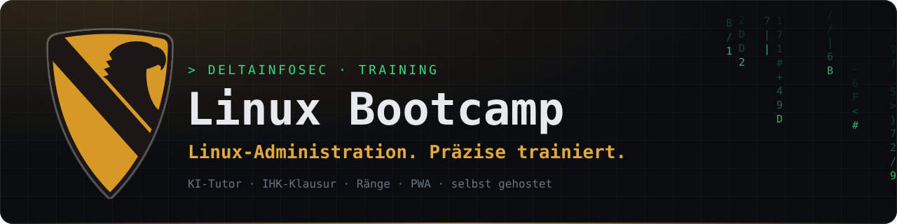
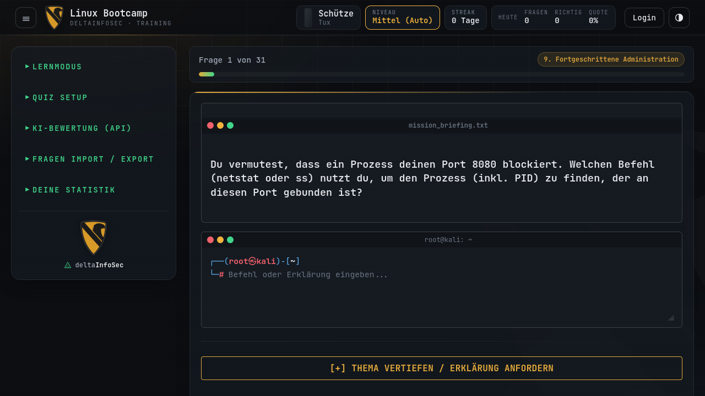

<div align="center">



<br>

**Interaktive, KI-gestützte Lernplattform (PWA) für angehende Linux-Administratoren.**<br>
<sub>Kommandozeile, Konfiguration und Server-Grundlagen. Mit XP, Rängen und Klausur-Modus.</sub>

<br>

[`Features`](#01-features) · [`Installation`](#02-installation--deployment) · [`Struktur`](#03-projektstruktur) · [`Corporate Design`](#04-corporate-design) · [`Sicherheit`](#05-sicherheit) · [`KI`](#07-ki-integration-einrichten)

</div>

<br>

<p align="center">
  
</p>

---

## `01` Features

| Modul | Beschreibung |
|---|---|
| **KI-Tutor** | Erklärt falsch beantwortete Fragen ausführlich im Ausbilder-Ton. Anbindung an Google Gemini, OpenAI, Groq, xAI, Together oder ein lokales Ollama. |
| **Klausur-Modus** | Simuliert eine IHK-Prüfung: 45 Minuten, 24 Fragen quer durch alle Kategorien, Note 1 bis 6. |
| **Ränge** | XP für richtige Antworten, Streaks und Dienstgrade von *Schütze* bis *General* (angelehnt an die Bundeswehr). |
| **PWA** | Installierbar auf Android, iOS und Desktop. Läuft dank Service Worker auch bei schlechter Verbindung. |
| **Admin-Konsole** | Benutzer und Rechte verwalten, alle abgelegten Klausuren einsehen, Inhalte pflegen. |
| **Docker** | Isoliertes Setup, das mit einem Skript auf jedem Linux-Server läuft. |

---

## `02` Installation & Deployment

### Voraussetzungen
- Ein Linux mit apt (Debian, Ubuntu, Raspberry Pi OS, Kali), `git` und `sudo`
- Docker wird vom Installationsskript bei Bedarf mitinstalliert

### Quickstart

Klone das Repo **als normaler Nutzer**, nicht mit `sudo`, und starte das Installationsskript:

```bash
git clone https://github.com/deltaInfoSecTeam/linux_bootcamp.git && cd linux_bootcamp && ./scripts/install.sh --admin <dein-username>
```

Das Skript
1. prüft, ob Docker und Docker Compose vorhanden sind, und installiert sie nach Rückfrage über apt,
2. korrigiert die Dateirechte (`data/` muss UID 1000 gehören, dem Nutzer im Container),
3. legt `.env` aus `.env.example` an,
4. baut und startet den Container und wartet auf den Healthcheck,
5. legt mit `--admin` den ersten Admin an. Passwort und Recovery-Token erscheinen **einmalig**.

Mehrfaches Ausführen schadet nicht, dasselbe Skript dient auch für Updates (`git pull && ./scripts/install.sh`). Weitere Optionen zeigt `./scripts/install.sh --help`.

Danach läuft die App unter `http://localhost:8000`. Standardmäßig ist sie **nur lokal** erreichbar (`127.0.0.1`).

### Manuelle Installation

Wer Docker selbst verwaltet (Compose v2 nötig):

```bash
cp .env.example .env && sudo chown -R 1000:1000 data && docker compose up -d --build
```

### Weitere Admins

```bash
sudo docker compose exec bootcamp node scripts/create-admin.js <username>
```

Existiert der Nutzer schon, wird er zum Admin. Sonst wird er neu angelegt, und Passwort plus Recovery-Token werden **einmalig** ausgegeben.

### Zugriff von außen (Server / LAN)

Öffne den Port nicht direkt, sondern setze einen Reverse Proxy mit HTTPS davor. Ein Beispiel mit Caddy, das das Zertifikat automatisch holt:

```
bootcamp.example.de {
    reverse_proxy 127.0.0.1:8000
}
```

Setze dazu in `.env` den Wert `TRUST_PROXY=1`. HTTPS ist für PWA-Funktionen auf Mobilgeräten ohnehin Pflicht.

### HTTPS im Heimnetz mit grünem Schloss (`--tls`)

Ohne öffentliche Domain gibt es kein Zertifikat von Let's Encrypt. Dafür bringt das Installationsskript eine eigene kleine Zertifizierungsstelle (CA) mit:

```bash
./scripts/install.sh --tls
```

Das Skript
1. erzeugt eine eigene CA und damit ein Zertifikat für `localhost`, den Hostnamen, `<hostname>.local` und die IP-Adressen des Rechners,
2. hinterlegt die CA als vertrauenswürdig im System (`curl`, `wget` …) sowie in Firefox und Chrome/Chromium des Nutzers, der das Skript startet (installiert dafür `libnss3-tools`),
3. trägt `TLS_CERT_PATH` und `TLS_KEY_PATH` in `.env` ein und startet den Container mit HTTPS.

Danach den Browser einmal neu starten. `https://localhost:8000` zeigt dann ein gültiges Zertifikat ohne Warnung.

**Sicherheit:** Die CA ist per *Name Constraints* auf lokale Namen (`localhost`, `.local`, `.lan`, `.home.arpa`, `.internal`, `.intern`, den Hostnamen) und private IP-Bereiche (`10/8`, `172.16/12`, `192.168/16`, `127/8`, `fc00::/7`) beschränkt. Selbst wenn ihr privater Schlüssel (`tls/ca/ca.key`, nur für root lesbar) in falsche Hände gerät, lassen sich damit keine Zertifikate für fremde Websites fälschen.

**Weitere Hostnamen**, z. B. eine interne Domain: in `.env` eintragen und das Skript erneut ausführen. Öffentliche Domains werden bewusst nur so aufgenommen. Jeder Eintrag erlaubt der CA auch alle Subdomains, deshalb nur eigene, vollständige Namen eintragen (z. B. `schule.lan`, nicht `lan` oder `com`); ungültige Einträge lehnt das Skript ab.

```
TLS_HOSTNAMES=bootcamp.intern.example.org,schule.lan
```

**Erneuerung:** Das Serverzertifikat gilt 825 Tage. Jeder weitere Lauf von `./scripts/install.sh` prüft es und stellt es neu aus, wenn es bald abläuft oder sich IP-Adresse oder Hostname geändert haben.

**Andere Geräte** (Handy, Laptop) vertrauen der CA erst, wenn du `tls/linux-bootcamp-ca.crt` dort importierst:
- **Android:** Einstellungen → Sicherheit → Verschlüsselung & Anmeldedaten → Zertifikat installieren → CA-Zertifikat
- **iOS/iPadOS:** Datei öffnen, Profil installieren, dann unter Einstellungen → Allgemein → Info → Zertifikatsvertrauenseinstellungen aktivieren
- **Windows:** Datei doppelklicken → Zertifikat installieren → „Vertrauenswürdige Stammzertifizierungsstellen“
- **Linux/macOS:** wie oben mit `sudo ./scripts/tls.sh trust` bzw. über die Schlüsselbundverwaltung

**Ohne Portnummer (Port 443):** Ist Port 443 frei, in `.env` einfach `HOST_PORT=443` setzen und das Skript erneut ausführen. Läuft auf dem Rechner schon ein nginx auf 443, kann er Bootcamp anhand des Namens weiterreichen (SNI), mit demselben Zertifikat:

```
server {
    listen 443 ssl default_server;
    server_name _;
    ssl_certificate     /pfad/zu/linux_bootcamp/tls/server/server.crt;
    ssl_certificate_key /pfad/zu/linux_bootcamp/tls/server/server.key;
    location / {
        proxy_pass https://127.0.0.1:8000;
        proxy_ssl_verify on;
        proxy_ssl_trusted_certificate /pfad/zu/linux_bootcamp/tls/linux-bootcamp-ca.crt;
        proxy_ssl_name localhost;
        proxy_set_header Host $host;
        proxy_set_header X-Forwarded-For $proxy_add_x_forwarded_for;
        proxy_set_header X-Forwarded-Proto $scheme;
    }
}
```

Dazu `TRUST_PROXY=1` in `.env`. Wird das Zertifikat erneuert, lädt `tls.sh` nginx automatisch neu.

**Verwalten:**

```bash
./scripts/tls.sh status           # Zertifikate und Ablaufdaten anzeigen
sudo ./scripts/tls.sh untrust     # CA aus System und Browsern entfernen
```

### Daten & Secrets

- Alles Persistente liegt in `./data/`: `bootcamp.db`, `.jwt_secret`, `.encryption_secret`.
- Die Secrets werden beim ersten Start zufällig erzeugt. Alternativ trägst du sie in `.env` ein.
- **Backup:** den Ordner `./data` sichern. Ohne `.encryption_secret` sind die gespeicherten API-Keys nicht mehr lesbar.
- Der Container läuft als Nutzer `node` (UID 1000). Gehört `./data` einem anderen Nutzer: `sudo chown -R 1000:1000 data`

### Update von v1.0.0

```bash
docker compose down && git pull && ./scripts/install.sh
```

Das Skript verschiebt eine vorhandene `bootcamp.db` automatisch nach `data/`. Beim ersten Start werden die alten Recovery-Codes gehasht und die API-Keys verschlüsselt. Alle Nutzer müssen sich einmal neu anmelden.

### Entwicklung ohne Docker

```bash
npm ci
npm start
```

---

## `03` Projektstruktur

```
├── server/            Backend (Express)
│   ├── index.js       Einstiegspunkt, Middleware, Static-Hosting von public/
│   ├── config.js      Konfiguration aus Umgebungsvariablen, Secrets
│   ├── db.js          SQLite-Zugriff und Migrationen
│   ├── crypto.js      Recovery-Code-Hashing, Verschlüsselung der API-Keys
│   ├── validation.js  Eingabeprüfung
│   ├── middleware/    auth, rateLimit, security (CSP & Header)
│   └── routes/        auth, admin, user, proxy
├── public/            Frontend – nur dieser Ordner wird ausgeliefert
│   ├── index.html  generator.html  manifest.json  sw.js
│   ├── css/           brand.css (Corporate Design), styles.css (App)
│   ├── fonts/         JetBrains Mono (selbst gehostet, SIL OFL)
│   ├── img/brand/     wappen.svg (zentrales Wappen), App-Icons
│   └── js/            theme, brand, boot, auth, core, questions, quiz, llm, stats, main, generator
├── scripts/           install.sh, tls.sh, brand-icons.sh, create-admin.js, healthcheck.js
├── docs/brand/        README-Banner (Vorlage + erzeugt), Screenshot
├── tools/content/     Rohdaten für Fragen (werden nicht ausgeliefert)
├── data/              Laufzeitdaten (gitignored)
├── Dockerfile  docker-compose.yml  .env.example
```

---

## `04` Corporate Design

Alle Seiten nutzen dieselbe Designschicht aus `public/css/brand.css` (Farben, Schriften, Kopfleiste, Hintergrund, Animationen) und `public/js/brand.js` (Matrix-Hintergrund, Text-Effekte). Standard ist das dunkle Design, unabhängig von der Systemeinstellung; ein helles lässt sich per Knopf wählen und wird gemerkt (`public/js/theme.js`). Alle Animationen entfallen bei „Bewegung reduzieren“.

| Element | Vorgabe |
|---|---|
| Wappen | `public/img/brand/wappen.svg`, immer sichtbar oben links in der Kopfleiste |
| Schrift | JetBrains Mono für alles, selbst gehostet |
| Hintergrund | Graphit `#0a0c10`, feines Raster, Matrix-Regen nur am Rand |
| Akzent | Wappen-Gold `#e2a83a` |
| Technik | Matrix-Grün `#3fd68a` für Labels (`> …`), Prompts und Status |
| Terminal | Root-Shell-Prompt `┌──(root㉿kali)-[~]` / `└─#` |
| Ton | ruhig und technisch; keine Maskottchen, keine Effekthascherei |

### Wappen austauschen

Das Wappen liegt an genau einer Stelle: `public/img/brand/wappen.svg`. Alle Seiten zeichnen es über CSS daraus (Kopfleiste, Seitenleiste, Dialoge, Wasserzeichen, Glanzeffekt).

1. `public/img/brand/wappen.svg` durch das neue Wappen ersetzen (SVG, transparenter Hintergrund).
2. Hat es andere Proportionen, in `public/css/brand.css` den Wert `--dis-crest-ratio` (Breite / Höhe) anpassen.
3. App-Icons und README-Banner neu erzeugen: `./scripts/brand-icons.sh`

Der Service Worker lädt Wappen und Design-Dateien immer zuerst aus dem Netz, installierte Apps sehen das neue Wappen also ohne Versionssprung.

### Design in einer neuen Seite nutzen

Eine neue Seite bekommt das Corporate Design mit diesen Zeilen:

```html
<head>
  <script src="js/theme.js"></script>
  <link rel="stylesheet" href="css/brand.css">
  <script src="js/brand.js" defer></script>
</head>
<body class="dis">
  <div class="dis-backdrop" aria-hidden="true"></div>
  <canvas class="dis-rain" aria-hidden="true"></canvas>
  <header class="dis-bar">
    <a class="dis-brand" href="./">
      <span class="dis-crest" role="img" aria-label="Wappen"></span>
      <span class="dis-brand-text"><span class="dis-brand-title">Titel</span></span>
    </a>
  </header>
</body>
```

Farben und Schriften stehen als CSS-Variablen (`--dis-*`) in `brand.css` bereit.

---

## `05` Sicherheit

- Ausgeliefert wird nur `public/`. Datenbank, Secrets und Server-Code sind nicht über HTTP erreichbar.
- Passwörter werden mit bcrypt gehasht, Recovery-Codes mit HMAC. Gespeicherte LLM-API-Keys sind mit AES-256-GCM verschlüsselt.
- Nach Passwortwechsel, Sperre oder Rechteänderung werden alle JWTs des Nutzers ungültig.
- Eine strikte Content-Security-Policy (`script-src 'self'`, Schriften nur vom eigenen Server) verhindert Inline-Skripte und Fremdeinbindungen.
- Der LLM-Proxy erreicht nur Gemini, OpenAI und die in `OLLAMA_URL` eingetragene Adresse.
- Der Container läuft ohne root, mit schreibgeschütztem Dateisystem und ohne Capabilities.

---

## `06` Technologie-Stack

- **Frontend:** Vanilla JavaScript, HTML5, CSS3, ohne Framework
- **Backend:** Node.js, Express
- **Datenbank:** SQLite (`bootcamp.db`, portabel und leichtgewichtig)
- **Authentifizierung:** JWT (JSON Web Tokens) & Bcrypt
- **Architektur:** Client-Server, PWA (Manifest & Service Worker)

---

## `07` KI-Integration einrichten

In der Seitenleiste unter **KI-Bewertung (API)** wählst du den LLM-Anbieter:
1. **Google Gemini (Empfohlen):** Füge deinen Gemini API Key ein.
2. **OpenAI:** Nutze `gpt-6-luna` oder ähnliche Modelle mit deinem OpenAI Key.
3. **Groq Cloud:** Kostenloser Zugang mit Rate-Limits, Schlüssel unter console.groq.com. Voreingestellt ist `openai/gpt-oss-120b`.
4. **Ollama:** Für den lokalen, komplett datenschutzkonformen Betrieb (z.B. Llama 3.1). Wähle `ollama` und gib die lokale URL deines Ollama-Servers an.

---

## `08` Lizenz

Dieses Projekt ist Open-Source und für Bildungszwecke konzipiert.

<br>

<div align="center">
  <br>
  <sub><code>&gt; deltaInfoSec · Linux Bootcamp</code></sub>
</div>
